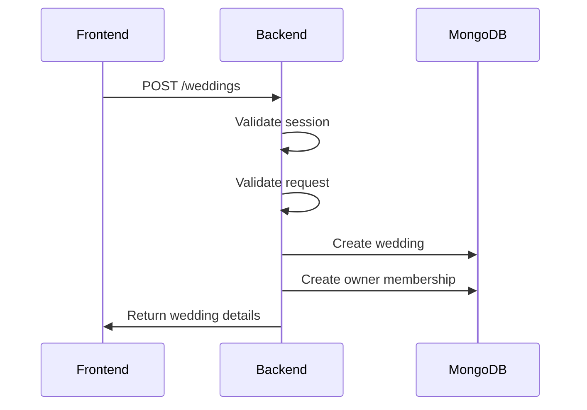
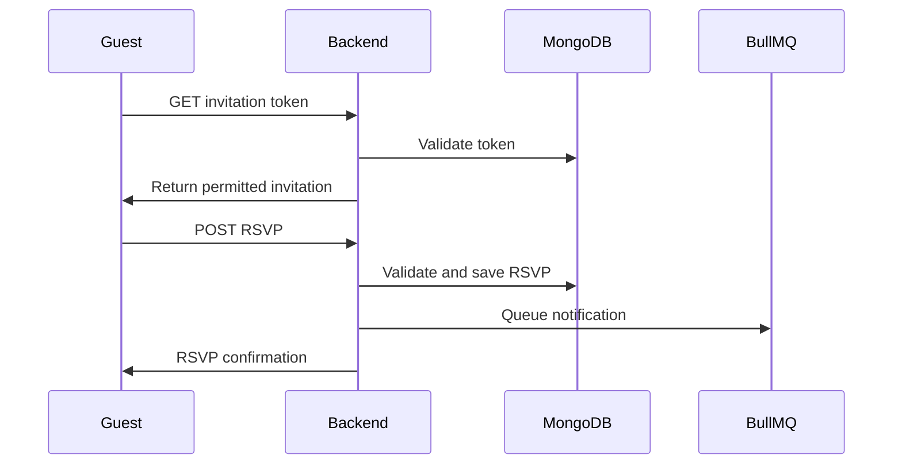
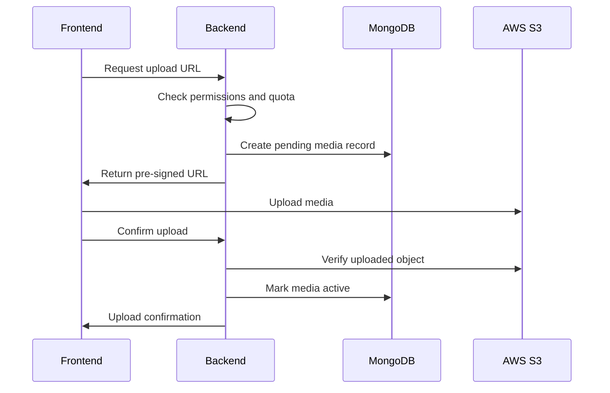

# Make My Marriage
# API Design Document (API-D)

**Document Version:** 1.0  
**API Style:** REST  
**API Format:** JSON  
**Base URL:** `/api/v1`  
**Backend:** Node.js + Express.js + TypeScript  
**Database:** MongoDB Atlas  
**Validation:** Zod  
**Documentation:** OpenAPI / Swagger  
**Authentication:** Server-side sessions

---

## 1. Introduction

### 1.1 Purpose

This document defines the API structure and communication standards for Make My Marriage.

It describes:
- API conventions.
- Authentication and authorization.
- Endpoint specifications.
- Request and response formats.
- Error handling.
- Pagination.
- Filtering and sorting.
- Security.
- External integrations.
- Important API workflows.

### 1.2 API Architecture

The backend exposes a versioned REST API.

All frontend communication with the backend will use JSON over HTTPS.

Base path:

`/api/v1`

Example:

`https://api.example.com/api/v1/weddings`

The frontend and backend will communicate through REST endpoints. S3 uploads will use pre-signed URLs.

---

## 2. API Design Standards

### 2.1 HTTP Methods

| Method | Purpose |
|---|---|
| GET | Retrieve resources |
| POST | Create resources or execute actions |
| PATCH | Partially update resources |
| PUT | Replace a resource when required |
| DELETE | Delete or deactivate resources |

### 2.2 Naming Convention

- Use lowercase resource names.
- Use plural nouns for collections.
- Use nested routes where the parent relationship is meaningful.
- Use path parameters for resource identifiers.
- Use query parameters for filtering and pagination.

Examples:

`GET /api/v1/weddings`

`GET /api/v1/weddings/:weddingId/events`

`POST /api/v1/weddings/:weddingId/guests`

### 2.3 Request Format

Content type:

`application/json`

Example:

```json
{
  "name": "Mehendi Ceremony",
  "startAt": "2027-02-10T10:00:00.000Z",
  "timezone": "Asia/Kolkata"
}
```

### 2.4 Response Format

Success response:

```json
{
  "success": true,
  "message": "Event created successfully",
  "data": {
    "id": "event_id",
    "name": "Mehendi Ceremony"
  }
}
```

Error response:

```json
{
  "success": false,
  "message": "Invalid request",
  "error": {
    "code": "VALIDATION_ERROR",
    "details": [
      {
        "field": "name",
        "message": "Name is required"
      }
    ]
  }
}
```

The response envelope will remain consistent across modules.

---

## 3. Authentication and Session Management

### 3.1 Authentication Method

The application will use server-side sessions.

Technologies:
- Express Session.
- connect-mongo.
- MongoDB Atlas.
- Argon2id.
- Secure HTTP-only cookies.

The browser will automatically send the session cookie with eligible requests.

The frontend should not store a session ID in localStorage or sessionStorage.

### 3.2 Authentication Endpoints

| Method | Endpoint | Description |
|---|---|---|
| POST | `/auth/register` | Register user |
| POST | `/auth/login` | Login |
| POST | `/auth/logout` | Logout |
| GET | `/auth/me` | Get current user |
| POST | `/auth/forgot-password` | Request password recovery |
| POST | `/auth/reset-password` | Reset password |
| POST | `/auth/verify-email` | Verify email |
| POST | `/auth/resend-verification` | Resend verification email |

### 3.3 Register User

**POST** `/api/v1/auth/register`

Request:

```json
{
  "name": "Example User",
  "email": "user@example.com",
  "password": "ExamplePassword123"
}
```

Response:

```json
{
  "success": true,
  "message": "Registration successful",
  "data": {
    "user": {
      "id": "user_id",
      "name": "Example User",
      "email": "user@example.com"
    }
  }
}
```

The API must not return the password hash.

### 3.4 Login

**POST** `/api/v1/auth/login`

Request:

```json
{
  "email": "user@example.com",
  "password": "ExamplePassword123"
}
```

Response:

```json
{
  "success": true,
  "message": "Login successful",
  "data": {
    "user": {
      "id": "user_id",
      "name": "Example User",
      "email": "user@example.com"
    }
  }
}
```

The session cookie is set through the HTTP response header.

### 3.5 Get Current User

**GET** `/api/v1/auth/me`

Response:

```json
{
  "success": true,
  "message": "Current user retrieved",
  "data": {
    "id": "user_id",
    "name": "Example User",
    "email": "user@example.com",
    "preferredLanguage": "en"
  }
}
```

---

## 4. User APIs

| Method | Endpoint | Description |
|---|---|---|
| GET | `/users/me` | Get profile |
| PATCH | `/users/me` | Update profile |
| PATCH | `/users/me/password` | Change password |
| PATCH | `/users/me/preferences` | Update preferences |
| DELETE | `/users/me` | Request account deletion |

Sensitive profile fields must be protected and only returned when required.

---

## 5. Wedding Workspace APIs

### 5.1 Endpoints

| Method | Endpoint | Description |
|---|---|---|
| POST | `/weddings` | Create wedding |
| GET | `/weddings` | List accessible weddings |
| GET | `/weddings/:weddingId` | Get wedding |
| PATCH | `/weddings/:weddingId` | Update wedding |
| DELETE | `/weddings/:weddingId` | Request workspace deletion |
| GET | `/weddings/:weddingId/overview` | Get dashboard overview |

### 5.2 Create Wedding

**POST** `/api/v1/weddings`

Request:

```json
{
  "name": "Example Wedding",
  "weddingDate": "2027-02-10",
  "timezone": "Asia/Kolkata",
  "currency": "INR",
  "location": {
    "city": "Nashik",
    "state": "Maharashtra",
    "country": "India"
  }
}
```

Response:

```json
{
  "success": true,
  "message": "Wedding created successfully",
  "data": {
    "id": "wedding_id",
    "name": "Example Wedding",
    "status": "active"
  }
}
```

The backend must create the initial owner membership as part of the workspace creation workflow.

---

## 6. Wedding Membership APIs

### 6.1 Endpoints

| Method | Endpoint | Description |
|---|---|---|
| GET | `/weddings/:weddingId/members` | List members |
| POST | `/weddings/:weddingId/members/invitations` | Invite member |
| PATCH | `/weddings/:weddingId/members/:memberId` | Update role or permissions |
| DELETE | `/weddings/:weddingId/members/:memberId` | Remove member |
| POST | `/member-invitations/:token/accept` | Accept membership invitation |

### 6.2 Invite Member

**POST** `/api/v1/weddings/:weddingId/members/invitations`

Request:

```json
{
  "email": "planner@example.com",
  "role": "planner",
  "permissions": [
    "events.read",
    "events.write",
    "guests.read"
  ]
}
```

Response:

```json
{
  "success": true,
  "message": "Invitation created successfully",
  "data": {
    "invitationId": "invitation_id",
    "status": "pending"
  }
}
```

Only users with appropriate membership-management permissions can invite or modify members.

---

## 7. Planner APIs

| Method | Endpoint | Description |
|---|---|---|
| GET | `/planners/me/profile` | Get planner profile |
| POST | `/planners/me/profile` | Create planner profile |
| PATCH | `/planners/me/profile` | Update planner profile |
| GET | `/planners/me/weddings` | List assigned weddings |

Planner access to wedding data remains governed by the wedding membership system.

---

## 8. Event Management APIs

### 8.1 Endpoints

| Method | Endpoint | Description |
|---|---|---|
| POST | `/weddings/:weddingId/events` | Create event |
| GET | `/weddings/:weddingId/events` | List events |
| GET | `/weddings/:weddingId/events/:eventId` | Get event |
| PATCH | `/weddings/:weddingId/events/:eventId` | Update event |
| DELETE | `/weddings/:weddingId/events/:eventId` | Delete event |

### 8.2 Create Event

**POST** `/api/v1/weddings/:weddingId/events`

Request:

```json
{
  "name": "Mehendi Ceremony",
  "description": "Mehendi celebration",
  "eventType": "ceremony",
  "startAt": "2027-02-10T10:00:00.000Z",
  "endAt": "2027-02-10T13:00:00.000Z",
  "timezone": "Asia/Kolkata"
}
```

Response:

```json
{
  "success": true,
  "message": "Event created successfully",
  "data": {
    "id": "event_id",
    "name": "Mehendi Ceremony"
  }
}
```

---

## 9. Guest Management APIs

### 9.1 Endpoints

| Method | Endpoint | Description |
|---|---|---|
| POST | `/weddings/:weddingId/guests` | Add guest |
| GET | `/weddings/:weddingId/guests` | List guests |
| GET | `/weddings/:weddingId/guests/:guestId` | Get guest |
| PATCH | `/weddings/:weddingId/guests/:guestId` | Update guest |
| DELETE | `/weddings/:weddingId/guests/:guestId` | Remove guest |
| POST | `/weddings/:weddingId/guests/import` | Import guests |
| GET | `/weddings/:weddingId/guests/export` | Export guests |

### 9.2 Create Guest

**POST** `/api/v1/weddings/:weddingId/guests`

Request:

```json
{
  "name": "Example Guest",
  "email": "guest@example.com",
  "phone": "+919876543210",
  "guestCount": 2
}
```

Response:

```json
{
  "success": true,
  "message": "Guest added successfully",
  "data": {
    "id": "guest_id",
    "name": "Example Guest"
  }
}
```

Guest records must always be scoped to the requested wedding.

---

## 10. Guest Group APIs

| Method | Endpoint | Description |
|---|---|---|
| POST | `/weddings/:weddingId/guest-groups` | Create group |
| GET | `/weddings/:weddingId/guest-groups` | List groups |
| PATCH | `/weddings/:weddingId/guest-groups/:groupId` | Update group |
| DELETE | `/weddings/:weddingId/guest-groups/:groupId` | Delete group |

---

## 11. Digital Invitation APIs

| Method | Endpoint | Description |
|---|---|---|
| GET | `/invitation-templates` | List active templates |
| GET | `/invitation-templates/:templateId` | Get template |
| POST | `/weddings/:weddingId/invitations` | Create invitation |
| GET | `/weddings/:weddingId/invitations` | List invitations |
| PATCH | `/weddings/:weddingId/invitations/:invitationId` | Update invitation |
| POST | `/weddings/:weddingId/invitations/:invitationId/send` | Send invitation |
| POST | `/weddings/:weddingId/invitations/:invitationId/revoke` | Revoke invitation |

### Invitation Creation

**POST** `/api/v1/weddings/:weddingId/invitations`

Request:

```json
{
  "guestId": "guest_id",
  "templateId": "template_id",
  "language": "en"
}
```

Response:

```json
{
  "success": true,
  "message": "Invitation created successfully",
  "data": {
    "invitationId": "invitation_id",
    "status": "created"
  }
}
```

Raw guest invitation tokens should be generated securely and stored only as hashes. The token must not be included in logs.

---

## 12. Guest RSVP APIs

Guest RSVP endpoints use invitation tokens rather than requiring registered guest accounts.

| Method | Endpoint | Description |
|---|---|---|
| GET | `/guest-invitations/:token` | Retrieve permitted invitation information |
| POST | `/guest-invitations/:token/rsvp` | Submit RSVP |
| PATCH | `/guest-invitations/:token/rsvp` | Update RSVP if permitted |

### Submit RSVP

**POST** `/api/v1/guest-invitations/:token/rsvp`

Request:

```json
{
  "response": "accepted",
  "attendeeCount": 2,
  "message": "Looking forward to attending"
}
```

Response:

```json
{
  "success": true,
  "message": "RSVP submitted successfully",
  "data": {
    "status": "accepted",
    "attendeeCount": 2
  }
}
```

The backend must verify the token's scope, expiry and revocation status.

It must not expose the complete wedding guest list through guest-facing endpoints.

---

## 13. Venue APIs

### 13.1 Venue Directory

| Method | Endpoint | Description |
|---|---|---|
| GET | `/venues` | Search venues |
| GET | `/venues/:venueId` | Get venue details |
| GET | `/venues/:venueId/services` | Get venue information and offerings |

Supported query parameters may include:
- `city`
- `state`
- `capacity`
- `page`
- `limit`
- `sort`

### 13.2 Venue Enquiries

| Method | Endpoint | Description |
|---|---|---|
| POST | `/weddings/:weddingId/venue-enquiries` | Create enquiry |
| GET | `/weddings/:weddingId/venue-enquiries` | List enquiries |
| GET | `/weddings/:weddingId/venue-enquiries/:enquiryId` | Get enquiry |
| PATCH | `/weddings/:weddingId/venue-enquiries/:enquiryId` | Update permitted fields |

### Create Venue Enquiry

Request:

```json
{
  "venueId": "venue_id",
  "eventDate": "2027-02-10",
  "guestCount": 300,
  "message": "Please share availability and pricing information."
}
```

The enquiry is not a confirmed booking.

---

## 14. Vendor APIs

### 14.1 Vendor Directory

| Method | Endpoint | Description |
|---|---|---|
| GET | `/vendors` | Search vendors |
| GET | `/vendors/:vendorId` | Get vendor details |
| GET | `/vendors/:vendorId/services` | List services |

### 14.2 Vendor Enquiries

| Method | Endpoint | Description |
|---|---|---|
| POST | `/weddings/:weddingId/vendor-enquiries` | Create enquiry |
| GET | `/weddings/:weddingId/vendor-enquiries` | List enquiries |
| GET | `/weddings/:weddingId/vendor-enquiries/:enquiryId` | Get enquiry |
| PATCH | `/weddings/:weddingId/vendor-enquiries/:enquiryId` | Update permitted fields |

### Create Vendor Enquiry

Request:

```json
{
  "vendorId": "vendor_id",
  "serviceId": "service_id",
  "eventDate": "2027-02-10",
  "message": "Please share your service details."
}
```

---

## 15. Budget and Expense APIs

| Method | Endpoint | Description |
|---|---|---|
| POST | `/weddings/:weddingId/expenses` | Create expense |
| GET | `/weddings/:weddingId/expenses` | List expenses |
| GET | `/weddings/:weddingId/expenses/:expenseId` | Get expense |
| PATCH | `/weddings/:weddingId/expenses/:expenseId` | Update expense |
| DELETE | `/weddings/:weddingId/expenses/:expenseId` | Delete expense |
| GET | `/weddings/:weddingId/budget/summary` | Get budget summary |

### Create Expense

Request:

```json
{
  "category": "venue",
  "description": "Wedding hall advance",
  "amount": 5000000,
  "currency": "INR",
  "paymentStatus": "paid"
}
```

The example amount is represented in paise: ₹50,000.00.

The API must document the monetary unit consistently and validate it. Financial calculations must not rely on JavaScript floating-point arithmetic.

---

## 16. Gallery and Media APIs

### 16.1 Album APIs

| Method | Endpoint | Description |
|---|---|---|
| POST | `/weddings/:weddingId/albums` | Create album |
| GET | `/weddings/:weddingId/albums` | List albums |
| GET | `/weddings/:weddingId/albums/:albumId` | Get album |
| PATCH | `/weddings/:weddingId/albums/:albumId` | Update album |
| DELETE | `/weddings/:weddingId/albums/:albumId` | Delete album |

### 16.2 Media APIs

| Method | Endpoint | Description |
|---|---|---|
| POST | `/media/upload-requests` | Request pre-signed upload |
| POST | `/media/:mediaId/confirm` | Confirm upload |
| GET | `/weddings/:weddingId/albums/:albumId/media` | List album media |
| POST | `/media/:mediaId/view-url` | Request authorized viewing URL |
| DELETE | `/media/:mediaId` | Delete media |

### 16.3 Upload Request

**POST** `/api/v1/media/upload-requests`

Request:

```json
{
  "weddingId": "wedding_id",
  "albumId": "album_id",
  "filename": "ceremony-photo.jpg",
  "mimeType": "image/jpeg",
  "fileSize": 2048000
}
```

Response:

```json
{
  "success": true,
  "message": "Upload URL generated",
  "data": {
    "mediaId": "media_id",
    "uploadUrl": "PRESIGNED_S3_URL",
    "expiresIn": 300
  }
}
```

The URL is temporary and must not be logged or reused after expiration.

The backend must check permissions, allowed MIME types, file size and storage quotas before issuing it.

### 16.4 Gallery Security

- Private albums require authenticated and authorized access.
- Restricted-link albums require a valid scoped access mechanism.
- Public visibility does not grant upload permission.
- Upload permission must be checked independently.
- Viewing URLs must be issued only after checking the relevant access policy.

---

## 17. Notifications APIs

| Method | Endpoint | Description |
|---|---|---|
| GET | `/notifications` | List current user's notifications |
| GET | `/notifications/unread-count` | Get unread count |
| PATCH | `/notifications/:notificationId/read` | Mark notification as read |
| POST | `/notifications/read-all` | Mark all as read |

Notifications must be scoped to the authenticated user.

---

## 18. Subscription APIs

| Method | Endpoint | Description |
|---|---|---|
| GET | `/subscription-plans` | List active plans |
| GET | `/weddings/:weddingId/subscription` | Get workspace subscription |
| POST | `/weddings/:weddingId/subscription/checkout` | Initiate subscription checkout |
| POST | `/weddings/:weddingId/subscription/cancel` | Request cancellation |
| GET | `/weddings/:weddingId/entitlements` | Get available workspace features |
| POST | `/webhooks/razorpay` | Process Razorpay webhook |

### Checkout Flow

1. Authorized workspace owner requests checkout.
2. Backend checks the selected plan.
3. Backend creates the payment/subscription request.
4. Frontend receives the required checkout information.
5. User completes payment with Razorpay.
6. Razorpay sends a webhook.
7. Backend verifies webhook signature.
8. Backend processes the event idempotently.
9. Subscription state and entitlements are updated.

Payment completion must never be trusted solely from a frontend redirect or browser callback.

Webhook endpoints must verify signatures using the raw request body as required by the provider.

---

## 19. Admin APIs

Admin APIs will be separated logically and protected by platform-level permissions.

| Method | Endpoint | Description |
|---|---|---|
| GET | `/admin/users` | List users |
| GET | `/admin/weddings` | List weddings |
| GET | `/admin/vendors` | List vendors |
| PATCH | `/admin/vendors/:vendorId/verification` | Update vendor verification |
| GET | `/admin/enquiries` | Review enquiries |
| GET | `/admin/audit-logs` | Review audit logs |

Platform administrator permissions must be independent of wedding workspace permissions.

---

## 20. Pagination, Filtering and Sorting

### 20.1 Pagination

Initial APIs will use page-based pagination.

Example:

`GET /api/v1/weddings/:weddingId/guests?page=1&limit=20`

Response:

```json
{
  "success": true,
  "message": "Guests retrieved",
  "data": [],
  "pagination": {
    "page": 1,
    "limit": 20,
    "total": 100,
    "totalPages": 5
  }
}
```

Large collections such as gallery media and notifications may use cursor-based pagination when needed.

### 20.2 Filtering

Example:

`GET /api/v1/weddings/:weddingId/events?status=scheduled`

### 20.3 Sorting

Example:

`GET /api/v1/weddings/:weddingId/events?sortBy=startAt&order=asc`

Only approved sort fields and filter fields will be accepted.

---

## 21. HTTP Status Codes

| Code | Meaning |
|---|---|
| 200 | OK |
| 201 | Created |
| 202 | Accepted for asynchronous processing |
| 204 | No Content |
| 400 | Bad Request |
| 401 | Unauthorized |
| 403 | Forbidden |
| 404 | Not Found |
| 409 | Conflict |
| 422 | Validation Error |
| 429 | Too Many Requests |
| 500 | Internal Server Error |
| 503 | Service Unavailable |

Do not expose stack traces or internal database errors in production responses.

---

## 22. Error Codes

Recommended application error codes:

| Code | Meaning |
|---|---|
| VALIDATION_ERROR | Request validation failed |
| AUTHENTICATION_REQUIRED | User must authenticate |
| INVALID_CREDENTIALS | Login credentials are invalid |
| SESSION_EXPIRED | Session is no longer valid |
| PERMISSION_DENIED | User lacks required permission |
| RESOURCE_NOT_FOUND | Resource does not exist or is inaccessible |
| WORKSPACE_ACCESS_DENIED | Wedding workspace access denied |
| DUPLICATE_RESOURCE | Resource already exists |
| INVALID_INVITATION_TOKEN | Invitation token is invalid |
| EXPIRED_INVITATION_TOKEN | Invitation token expired |
| INVALID_UPLOAD | File upload is invalid |
| STORAGE_LIMIT_EXCEEDED | Workspace storage quota exceeded |
| PAYMENT_VERIFICATION_FAILED | Payment verification failed |
| RATE_LIMIT_EXCEEDED | Request limit exceeded |
| INTERNAL_SERVER_ERROR | Unexpected server error |

---

## 23. Authorization Architecture

Authorization will be implemented in layers.

### Layer 1: Authentication

Check whether the request has a valid session.

### Layer 2: Workspace Membership

Check whether the user belongs to the requested wedding.

### Layer 3: Permission Check

Check whether the user's role and permissions allow the requested action.

### Layer 4: Resource Ownership and Scope

Verify that the requested resource belongs to the authorized wedding.

### Layer 5: Business Rules

Verify additional business restrictions, such as subscription entitlements or resource status.

Frontend role checks are for user experience only. All authorization decisions must be enforced on the backend.

---

## 24. Security Requirements

- HTTPS in production.
- HTTP-only secure session cookies.
- CSRF protection for state-changing cookie-authenticated requests.
- Strict CORS allowlisting.
- Helmet security headers.
- Rate limiting.
- Zod validation.
- Object-level authorization.
- Workspace-level tenant isolation.
- Secure invitation tokens.
- Safe file upload validation.
- Private S3 storage.
- Verified payment webhooks.
- No secret values in logs.
- No direct exposure of database documents.
- Consistent response sanitization.

Public endpoints must have appropriate rate limits and must reveal only the minimum information needed.

---

## 25. API Documentation

Technology: Swagger / OpenAPI.

The backend will expose API documentation through an appropriate development or restricted staging endpoint.

The OpenAPI specification will document:
- Endpoint paths.
- HTTP methods.
- Parameters.
- Request schemas.
- Response schemas.
- Authentication requirements.
- Error responses.
- Pagination.
- Authorization requirements.

The API specification should be maintained alongside the backend code.

---

## 26. Important API Workflows

### 26.1 Wedding Creation Workflow



### 26.2 Guest RSVP Workflow



### 26.3 Media Upload Workflow



---

## 27. API Versioning Strategy

The initial API version will be:

`/api/v1`

Breaking API changes will require a new version where backward compatibility cannot be maintained.

Non-breaking additions may be introduced within the existing version.

---

## 28. Implementation Priorities

Recommended implementation order:

### Phase 1: Foundation
- Authentication.
- User profile.
- Wedding workspaces.
- Membership and permissions.
- Standard API middleware.

### Phase 2: Core Wedding Management
- Events.
- Guests.
- Guest groups.
- Digital invitations.
- RSVP.

### Phase 3: Wedding Operations
- Venues.
- Vendors.
- Enquiries.
- Budget and expenses.

### Phase 4: Media and Communication
- Albums.
- S3 media uploads.
- Notifications.
- Transactional emails.

### Phase 5: Monetization and Administration
- Subscription plans.
- Razorpay integration.
- Entitlements.
- Admin APIs.

### Phase 6: Quality and Release
- Security testing.
- Integration testing.
- E2E testing.
- OpenAPI documentation.
- Production deployment.

---

## 29. Conclusion

The Make My Marriage API will use a versioned REST architecture built with Express.js and TypeScript.

All API modules will follow consistent conventions for:
- Naming.
- Request validation.
- Authentication.
- Authorization.
- Responses.
- Error handling.
- Pagination.
- Security.

The API will enforce workspace isolation and permission checks at the backend level.

**Document Status:** Proposed API baseline for implementation. Endpoint schemas and OpenAPI definitions should be finalized alongside the implementation of each module.