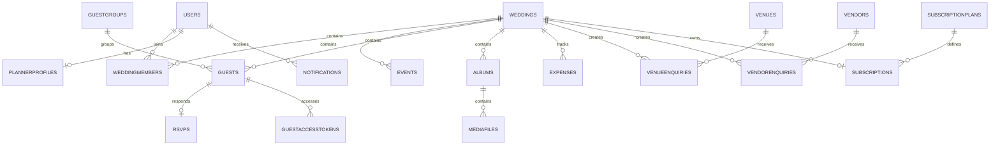

# Make My Marriage
# Database Design Document (DDD)

**Document Version:** 1.0  
**Database:** MongoDB Atlas  
**ODM:** Mongoose  
**Backend:** Node.js + Express.js + TypeScript  
**Architecture:** Modular Monolith  
**API Version:** `/api/v1`

---

## 1. Introduction

### 1.1 Purpose

This document defines the database architecture and data model for Make My Marriage.

It describes:
- Database collections.
- Document structures.
- Relationships between collections.
- Embedded and referenced documents.
- Indexing strategy.
- Data validation.
- Multi-tenant data isolation.
- Security and data lifecycle requirements.

### 1.2 Database Technology

**MongoDB Atlas** will be used as the primary database.

Mongoose will provide:
- Schema definitions.
- Document validation.
- Relationships through references.
- Query operations.
- Middleware and model-level logic.

### 1.3 Database Design Approach

The application will use a hybrid data-modelling approach.

**Embedding:** Used for small, bounded data that is usually accessed together.

Examples:
- Wedding address.
- Theme configuration.
- Small preference objects.
- Snapshot information.

**Referencing:** Used for independently managed or potentially large collections.

Examples:
- Users.
- Weddings.
- Guests.
- Events.
- Media files.
- Expenses.
- Notifications.

---

## 2. Database Architecture

### 2.1 Database Name

`make_my_marriage`

### 2.2 Collection Naming Convention

Use lowercase plural names.

Examples:
- `users`
- `weddings`
- `weddingmembers`
- `events`
- `guests`
- `rsvps`
- `mediafiles`

### 2.3 Common Document Fields

Most business documents will include:

| Field | Type | Purpose |
|---|---|---|
| `_id` | ObjectId | Unique document identifier |
| `createdAt` | Date | Creation timestamp |
| `updatedAt` | Date | Last update timestamp |

Mongoose timestamps will automatically manage `createdAt` and `updatedAt`.

Documents that need soft deletion will additionally use:

`deletedAt: Date | null`

Soft deletion must be applied selectively. It is not a substitute for retention and privacy deletion policies.

---

## 3. Collection Design

### 3.1 Users Collection

**Collection:** `users`

Stores registered application accounts.

| Field | Type | Required |
|---|---|---|
| `_id` | ObjectId | Yes |
| `name` | String | Yes |
| `email` | String | Yes |
| `phone` | String | No |
| `passwordHash` | String | Yes |
| `profileImage` | String | No |
| `preferredLanguage` | String | Yes |
| `emailVerifiedAt` | Date | No |
| `phoneVerifiedAt` | Date | No |
| `status` | String | Yes |
| `createdAt` | Date | Yes |
| `updatedAt` | Date | Yes |

Example:

```json
{
  "_id": "ObjectId",
  "name": "Example User",
  "email": "user@example.com",
  "phone": "+919876543210",
  "passwordHash": "hashed_password",
  "preferredLanguage": "en",
  "status": "active"
}
```

Indexes:
- Unique normalized email.
- Phone index if phone-based lookup is required.
- Status index if frequently used by administration.

The system must never store plain-text passwords.

---

### 3.2 Weddings Collection

**Collection:** `weddings`

Stores wedding workspace information.

| Field | Type | Required |
|---|---|---|
| `_id` | ObjectId | Yes |
| `name` | String | Yes |
| `slug` | String | Yes |
| `ownerId` | ObjectId | Yes |
| `weddingDate` | Date | No |
| `timezone` | String | Yes |
| `currency` | String | Yes |
| `location` | Object | No |
| `theme` | Object | No |
| `settings` | Object | No |
| `status` | String | Yes |
| `createdAt` | Date | Yes |
| `updatedAt` | Date | Yes |

Example:

```json
{
  "_id": "ObjectId",
  "name": "Example Wedding",
  "slug": "example-wedding",
  "ownerId": "ObjectId",
  "weddingDate": "2027-02-10T00:00:00.000Z",
  "timezone": "Asia/Kolkata",
  "currency": "INR",
  "location": {
    "city": "Nashik",
    "state": "Maharashtra",
    "country": "India"
  },
  "settings": {
    "galleryVisibility": "private",
    "guestRsvpEnabled": true
  },
  "status": "active"
}
```

Indexes:
- Unique slug where uniqueness is required.
- `ownerId`.
- `status`.

The wedding workspace is the primary tenant boundary.

---

### 3.3 Wedding Members Collection

**Collection:** `weddingmembers`

Connects users with wedding workspaces.

This collection supports many-to-many relationships.

| Field | Type | Required |
|---|---|---|
| `_id` | ObjectId | Yes |
| `weddingId` | ObjectId | Yes |
| `userId` | ObjectId | Yes |
| `role` | String | Yes |
| `permissions` | Array | No |
| `status` | String | Yes |
| `invitedBy` | ObjectId | No |
| `joinedAt` | Date | No |
| `createdAt` | Date | Yes |

Example:

```json
{
  "_id": "ObjectId",
  "weddingId": "ObjectId",
  "userId": "ObjectId",
  "role": "planner",
  "permissions": [
    "events.read",
    "events.write",
    "guests.read",
    "guests.write"
  ],
  "status": "active"
}
```

Roles:
- owner
- family
- planner

Unique compound index:

`{ weddingId: 1, userId: 1 }`

A user can belong to multiple weddings, and a planner can manage multiple wedding workspaces.

---

### 3.4 Planner Profiles Collection

**Collection:** `plannerprofiles`

Stores additional information about wedding planners.

| Field | Type | Required |
|---|---|---|
| `_id` | ObjectId | Yes |
| `userId` | ObjectId | Yes |
| `businessName` | String | No |
| `description` | String | No |
| `serviceAreas` | Array | No |
| `experienceYears` | Number | No |
| `portfolioMediaIds` | Array | No |
| `verificationStatus` | String | Yes |

A planner's access to individual weddings is controlled by `weddingmembers`, not merely by having a planner profile.

---

### 3.5 Events Collection

**Collection:** `events`

Stores ceremonies, rituals and wedding activities.

| Field | Type | Required |
|---|---|---|
| `_id` | ObjectId | Yes |
| `weddingId` | ObjectId | Yes |
| `name` | String | Yes |
| `description` | String | No |
| `eventType` | String | No |
| `startAt` | Date | Yes |
| `endAt` | Date | No |
| `timezone` | String | Yes |
| `venue` | Object | No |
| `assignedMembers` | Array | No |
| `status` | String | Yes |
| `createdBy` | ObjectId | Yes |

Example:

```json
{
  "_id": "ObjectId",
  "weddingId": "ObjectId",
  "name": "Mehendi Ceremony",
  "eventType": "ceremony",
  "startAt": "2027-02-10T10:00:00.000Z",
  "endAt": "2027-02-10T13:00:00.000Z",
  "timezone": "Asia/Kolkata",
  "venue": {
    "name": "Example Hall",
    "city": "Nashik"
  },
  "status": "scheduled"
}
```

Indexes:
- `{ weddingId: 1, startAt: 1 }`
- `{ weddingId: 1, status: 1 }`

---

### 3.6 Guests Collection

**Collection:** `guests`

Stores guest and household information.

| Field | Type | Required |
|---|---|---|
| `_id` | ObjectId | Yes |
| `weddingId` | ObjectId | Yes |
| `name` | String | Yes |
| `email` | String | No |
| `phone` | String | No |
| `groupId` | ObjectId | No |
| `householdId` | ObjectId | No |
| `guestCount` | Number | No |
| `invitationStatus` | String | Yes |
| `notes` | String | No |
| `createdAt` | Date | Yes |

Example:

```json
{
  "_id": "ObjectId",
  "weddingId": "ObjectId",
  "name": "Example Guest",
  "email": "guest@example.com",
  "phone": "+919876543210",
  "guestCount": 2,
  "invitationStatus": "sent"
}
```

Indexes:
- `{ weddingId: 1, createdAt: -1 }`
- `{ weddingId: 1, groupId: 1 }`
- `{ weddingId: 1, phone: 1 }` where appropriate.

Guest information must not be exposed through public invitation endpoints.

---

### 3.7 Guest Groups Collection

**Collection:** `guestgroups`

Groups guests into categories such as:
- Bride's family.
- Groom's family.
- Friends.
- Relatives.
- Office colleagues.

Fields:
- `_id`
- `weddingId`
- `name`
- `description`
- `createdAt`
- `updatedAt`

Index:

`{ weddingId: 1, name: 1 }`

---

### 3.8 RSVPs Collection

**Collection:** `rsvps`

Stores guest responses.

| Field | Type | Required |
|---|---|---|
| `_id` | ObjectId | Yes |
| `weddingId` | ObjectId | Yes |
| `guestId` | ObjectId | Yes |
| `response` | String | Yes |
| `attendeeCount` | Number | Yes |
| `eventResponses` | Array | No |
| `message` | String | No |
| `respondedAt` | Date | Yes |

Example:

```json
{
  "_id": "ObjectId",
  "weddingId": "ObjectId",
  "guestId": "ObjectId",
  "response": "accepted",
  "attendeeCount": 2,
  "respondedAt": "2027-01-15T10:00:00.000Z"
}
```

Unique compound index:

`{ weddingId: 1, guestId: 1 }`

If multiple response records per guest are needed later, this constraint can be revised.

---

### 3.9 Guest Access Tokens Collection

**Collection:** `guestaccesstokens`

Stores hashed invitation access tokens.

Fields:
- `_id`
- `weddingId`
- `guestId`
- `tokenHash`
- `scopes`
- `expiresAt`
- `revokedAt`
- `createdAt`

Example:

```json
{
  "_id": "ObjectId",
  "weddingId": "ObjectId",
  "guestId": "ObjectId",
  "tokenHash": "sha256_token_hash",
  "scopes": [
    "invitation.read",
    "rsvp.write"
  ],
  "expiresAt": "2027-03-01T00:00:00.000Z",
  "revokedAt": null
}
```

The raw token is returned only when the invitation link is generated. It is never stored in the database.

Indexes:
- Unique `tokenHash`.
- `expiresAt` for expiration cleanup.
- `weddingId` and `guestId`.

Expired and revoked tokens must be rejected even if their database records remain present.

---

### 3.10 Invitation Templates Collection

**Collection:** `invitationtemplates`

Stores reusable digital invitation designs.

Fields:
- `_id`
- `name`
- `description`
- `thumbnailMediaId`
- `designConfiguration`
- `supportedLanguages`
- `isActive`
- `createdAt`

Wedding-specific invitation content and customization should be stored separately or as a bounded configuration on the wedding invitation record.

---

### 3.11 Venues Collection

**Collection:** `venues`

Stores venue directory information.

Fields:
- `_id`
- `name`
- `description`
- `address`
- `city`
- `state`
- `country`
- `coordinates`
- `capacity`
- `contactInformation`
- `mediaIds`
- `verificationStatus`
- `createdAt`

Indexes:
- `{ city: 1, verificationStatus: 1 }`
- `{ state: 1, city: 1 }`

Venue enquiries are separate records.

---

### 3.12 Venue Enquiries Collection

**Collection:** `venueenquiries`

Fields:
- `_id`
- `weddingId`
- `venueId`
- `submittedBy`
- `eventDate`
- `guestCount`
- `message`
- `status`
- `createdAt`
- `updatedAt`

Statuses:
- pending
- contacted
- responded
- closed

An enquiry does not represent a confirmed booking.

---

### 3.13 Vendors Collection

**Collection:** `vendors`

Stores vendor directory information.

Fields:
- `_id`
- `name`
- `businessName`
- `description`
- `categories`
- `serviceAreas`
- `address`
- `contactInformation`
- `mediaIds`
- `verificationStatus`
- `createdAt`

---

### 3.14 Vendor Services Collection

**Collection:** `vendorservices`

Stores vendor service offerings.

Fields:
- `_id`
- `vendorId`
- `name`
- `description`
- `category`
- `priceRange`
- `isActive`

---

### 3.15 Vendor Enquiries Collection

**Collection:** `vendorenquiries`

Fields:
- `_id`
- `weddingId`
- `vendorId`
- `serviceId`
- `submittedBy`
- `eventDate`
- `message`
- `status`
- `createdAt`
- `updatedAt`

---

### 3.16 Albums Collection

**Collection:** `albums`

Stores wedding gallery albums.

Fields:
- `_id`
- `weddingId`
- `name`
- `description`
- `visibility`
- `createdBy`
- `createdAt`
- `updatedAt`

Visibility:
- private
- restricted_link
- public

The default must be private.

---

### 3.17 Media Files Collection

**Collection:** `mediafiles`

Stores metadata for S3 objects.

Fields:
- `_id`
- `weddingId`
- `albumId`
- `uploadedBy`
- `objectKey`
- `originalFilename`
- `mimeType`
- `fileSize`
- `mediaType`
- `status`
- `createdAt`
- `deletedAt`

Example:

```json
{
  "_id": "ObjectId",
  "weddingId": "ObjectId",
  "albumId": "ObjectId",
  "uploadedBy": "ObjectId",
  "objectKey": "weddings/wedding_id/media/generated_id",
  "originalFilename": "ceremony-photo.jpg",
  "mimeType": "image/jpeg",
  "fileSize": 2048000,
  "mediaType": "image",
  "status": "active"
}
```

Indexes:
- `{ weddingId: 1, albumId: 1, createdAt: -1 }`
- `{ weddingId: 1, status: 1 }`

The actual media binary is stored in S3, not MongoDB.

---

### 3.18 Expenses Collection

**Collection:** `expenses`

Stores wedding budget information.

Fields:
- `_id`
- `weddingId`
- `category`
- `description`
- `amount`
- `currency`
- `expenseDate`
- `paymentStatus`
- `vendorId`
- `createdBy`
- `createdAt`

Indexes:
- `{ weddingId: 1, expenseDate: -1 }`
- `{ weddingId: 1, category: 1 }`

All amounts must use a consistent currency and monetary representation. Use integer minor units where supported by the payment or reporting model, or a carefully validated decimal representation. Do not use floating-point arithmetic for financial calculations.

---

### 3.19 Notifications Collection

**Collection:** `notifications`

Stores in-app notifications.

Fields:
- `_id`
- `userId`
- `weddingId`
- `type`
- `title`
- `message`
- `resourceType`
- `resourceId`
- `readAt`
- `createdAt`

Indexes:
- `{ userId: 1, createdAt: -1 }`
- `{ userId: 1, readAt: 1 }`

---

### 3.20 Subscription Plans Collection

**Collection:** `subscriptionplans`

Stores free and premium plan definitions.

Fields:
- `_id`
- `name`
- `code`
- `price`
- `currency`
- `billingInterval`
- `features`
- `limits`
- `isActive`

The application must use backend-controlled plan definitions and entitlements.

---

### 3.21 Subscriptions Collection

**Collection:** `subscriptions`

Stores workspace subscription information.

Fields:
- `_id`
- `weddingId`
- `planId`
- `billingOwnerId`
- `provider`
- `providerSubscriptionId`
- `status`
- `currentPeriodStart`
- `currentPeriodEnd`
- `cancelAtPeriodEnd`
- `createdAt`
- `updatedAt`

Indexes:
- `{ weddingId: 1 }`
- Unique provider subscription ID where present.

Payment provider webhook events must be verified and processed idempotently.

A separate payment transaction collection should be introduced when payment history and reconciliation requirements demand it.

---

### 3.22 Sessions Collection

**Collection:** `sessions`

Stores server-side authentication sessions using connect-mongo.

Session data is managed by the session middleware. The application must not expose session identifiers or session contents through normal APIs.

---

### 3.23 Audit Logs Collection

**Collection:** `auditlogs`

Stores important security and administrative events.

Fields:
- `_id`
- `actorUserId`
- `weddingId`
- `action`
- `resourceType`
- `resourceId`
- `metadata`
- `createdAt`

Examples:
- Member role changed.
- Wedding ownership changed.
- Invitation token revoked.
- Gallery visibility changed.
- Subscription entitlement changed.

Avoid storing unnecessary personal information or secrets in audit metadata.

---

## 4. Entity Relationship Overview



---

## 5. Multi-Tenant Data Isolation

Every wedding-owned document must contain a `weddingId`.

Examples:
- Events.
- Guests.
- RSVPs.
- Albums.
- Media files.
- Expenses.
- Enquiries.
- Wedding-specific notifications.

### Mandatory Rules

1. Resolve the active wedding membership on the backend.
2. Verify the user's membership status.
3. Verify permission for the requested action.
4. Include the authorized `weddingId` in database queries.
5. Never trust client-supplied tenant identifiers without authorization.
6. Prevent cross-wedding access even when a user knows another document's ObjectId.
7. Apply tenant scoping to updates and deletions as well as reads.

A user may have memberships in several weddings, but every request must be authorized against the specific workspace being accessed.

---

## 6. Indexing Strategy

Initial index priorities:

| Collection | Index |
|---|---|
| users | Unique normalized email |
| weddings | Unique slug |
| weddingmembers | Unique weddingId + userId |
| events | weddingId + startAt |
| guests | weddingId + createdAt |
| rsvps | Unique weddingId + guestId |
| guestaccesstokens | Unique tokenHash |
| albums | weddingId + createdAt |
| mediafiles | weddingId + albumId + createdAt |
| expenses | weddingId + expenseDate |
| notifications | userId + createdAt |
| venueenquiries | weddingId + createdAt |
| vendorenquiries | weddingId + createdAt |

Indexes should be validated against actual query patterns and production query performance.

---

## 7. Data Validation Rules

- Validate required fields.
- Validate email and phone formats.
- Validate ObjectId references.
- Validate enum values such as role and status.
- Validate date ranges.
- Ensure end dates are later than start dates where applicable.
- Prevent negative guest counts and expense amounts.
- Validate currency codes.
- Validate media size and file type.
- Validate subscription status transitions.
- Prevent unauthorized modification of tenant identifiers.

Use Zod at the API boundary and Mongoose validation as an additional persistence-level safeguard.

---

## 8. Data Consistency and Transactions

MongoDB Atlas supports transactions on supported cluster configurations.

Use transactions when multiple related writes must succeed or fail together.

Examples:
- Creating a wedding and its initial owner membership.
- Creating a subscription record and updating associated entitlement state.
- Processing sensitive multi-document changes.

For asynchronous workflows:
- Use idempotent jobs.
- Record processing state.
- Retry transient failures.
- Avoid assuming that a queue job executes exactly once.

Where reliable event delivery is essential, use an outbox-style pattern so business changes and event records are persisted consistently.

---

## 9. Data Security

- Never store plain-text passwords.
- Store hashes of guest access tokens.
- Restrict database access by environment.
- Use TLS connections.
- Keep database credentials in environment secrets.
- Apply workspace-level access checks.
- Restrict sensitive user fields from API responses.
- Avoid logging secrets and session information.
- Apply least-privilege access to application database accounts.
- Encrypt and back up sensitive data appropriately.

---

## 10. Data Lifecycle and Deletion

The system must define retention policies for:

- User accounts.
- Wedding workspaces.
- Guest information.
- Invitations and access tokens.
- Media files.
- Payment records.
- Audit logs.
- Background job records.

Deletion workflows must account for related documents and S3 objects.

Do not cascade-delete a wedding's media or records merely because one member is removed.

A workspace deletion workflow should:
1. Verify owner authorization.
2. Check retention and legal requirements.
3. Mark the workspace as pending deletion.
4. Revoke access tokens and sessions as appropriate.
5. Remove or anonymize data according to the approved policy.
6. Delete S3 objects when permitted.
7. Record completion in an audit trail.

---

## 11. Future Database Improvements

Potential future enhancements:
- MongoDB Atlas Search.
- Advanced analytics collections.
- Dedicated payment transaction records.
- Media moderation records.
- More detailed notification delivery records.
- Advanced vendor reviews and ratings.
- Data archival strategies.

These are not mandatory for the first MVP.

---

## 12. Conclusion

MongoDB Atlas with Mongoose will provide the primary persistence layer for Make My Marriage.

The database will use a shared-database, workspace-isolated model with hybrid embedding and referencing.

The most important database design principles are:
- Wedding-level tenant isolation.
- Explicit membership and permission records.
- Secure guest access tokens.
- Private media metadata and S3 storage.
- Carefully designed indexes.
- Consistent financial data.
- Reliable deletion and retention workflows.

**Document Status:** Proposed database baseline for implementation. Exact Mongoose schemas and migrations should be developed from this specification.