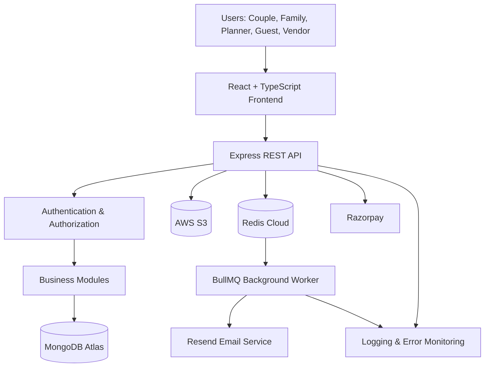

# Make My Marriage
## System Design & Architecture Document (SDAD)

**Document Version:** 1.0  
**Project:** Make My Marriage  
**Architecture Style:** Modular Monolith  
**Technology Stack:** MERN + TypeScript  
**Deployment Platform:** Render  
**Database:** MongoDB Atlas  
**Media Storage:** AWS S3

---

# 1. Introduction

## 1.1 Project Overview

Make My Marriage is an Indian wedding management platform designed to simplify wedding planning by bringing couples, families, wedding planners, guests, venues and vendors together in one application.

The platform provides tools to manage wedding events, invitations, guest lists, RSVPs, budgets, galleries, venues and vendors.

It supports both self-managed weddings and planner-assisted weddings.

## 1.2 Project Objectives

- Simplify wedding planning and coordination.
- Allow families to collaborate on wedding activities.
- Enable wedding planners to manage multiple weddings.
- Provide digital invitations and guest RSVP management.
- Help users discover venues and vendors.
- Provide a centralized wedding dashboard.
- Support English, Marathi and Hindi.
- Provide secure photo and video sharing.
- Offer free and premium subscription plans.

## 1.3 Target Users

1. Couples and wedding owners
2. Family members
3. Wedding planners
4. Wedding guests
5. Venue owners and managers
6. Vendors
7. Platform administrators

---

# 2. Architecture Overview

## 2.1 Selected Architecture

**Modular Monolithic Architecture**

The application will have one React frontend and one logically unified Express backend.

The backend will be divided into independent business modules. Each module will have its own responsibilities and internal structure.

The API and background worker will run as separate processes, but they will share the same backend codebase.

### Why Modular Monolith?

- Easier to develop and maintain initially.
- Lower infrastructure complexity.
- Faster MVP development.
- Clear separation of business responsibilities.
- Easier debugging and testing.
- Modules can be extracted into separate services in the future if necessary.

## 2.2 High-Level Architecture



## 2.3 Architecture Components

| Component | Responsibility |
|---|---|
| React Frontend | User interface and application interactions |
| Express API | Handles HTTP requests and business operations |
| Authentication | User login, sessions and access control |
| Business Modules | Wedding-related business functionality |
| MongoDB Atlas | Persistent application data |
| AWS S3 | Media and document storage |
| Redis Cloud | Background job queue storage |
| BullMQ Worker | Processes asynchronous jobs |
| Resend | Transactional email delivery |
| Razorpay | Subscription payments |
| Pino / Sentry | Logging and error monitoring |

---

# 3. Technology Stack

## 3.1 Frontend

| Technology | Responsibility |
|---|---|
| React | UI development |
| TypeScript | Type safety |
| Vite | Development server and build tool |
| React Router | Application routing |
| TanStack Query | Server-state management |
| Zustand | Global client state |
| Tailwind CSS | Styling |
| shadcn/ui | UI components |
| Radix UI | Accessible UI primitives |
| React Hook Form | Form management |
| Zod | Form and data validation |
| i18next | Multilingual support |
| date-fns | Date manipulation |
| Lucide React | Icons |

### Frontend State Management

Three different approaches will be used:

- **TanStack Query:** Data received from backend APIs.
- **Zustand:** Shared client-side state, such as active workspace and user preferences.
- **React useState/useReducer:** Local component state.

The application will avoid storing duplicate server data in Zustand.

## 3.2 Backend

| Technology | Responsibility |
|---|---|
| Node.js | JavaScript runtime |
| Express.js | Backend framework |
| TypeScript | Type safety |
| Mongoose | MongoDB object modelling |
| Zod | Request validation |
| Express Session | Server-side session authentication |
| connect-mongo | MongoDB session storage |
| Argon2id | Password hashing |
| BullMQ | Background job processing |
| Pino | Structured logging |
| Helmet | HTTP security headers |
| CORS | Cross-origin access configuration |
| express-rate-limit | API rate limiting |
| Swagger / OpenAPI | API documentation |

## 3.3 Infrastructure

| Technology | Responsibility |
|---|---|
| MongoDB Atlas | Main database |
| AWS S3 | Media storage |
| Redis Cloud | Queue infrastructure |
| Render Static Site | Frontend hosting |
| Render Web Service | Backend API hosting |
| Render Background Worker | Background jobs |
| GitHub | Source code repository |
| GitHub Actions | CI/CD |
| Sentry | Error monitoring |
| Resend | Email service |
| Razorpay | Subscription payments |

---

# 4. Application Structure

## 4.1 Frontend Architecture

One React application will serve all application roles.

Role-based routing and permission checks will determine which screens users can access.

```text
frontend/
│
├── public/
│
├── src/
│   ├── app/
│   │   ├── router/
│   │   ├── providers/
│   │   └── layouts/
│   │
│   ├── modules/
│   │   ├── authentication/
│   │   ├── dashboard/
│   │   ├── weddings/
│   │   ├── events/
│   │   ├── guests/
│   │   ├── invitations/
│   │   ├── rsvp/
│   │   ├── venues/
│   │   ├── vendors/
│   │   ├── budget/
│   │   ├── gallery/
│   │   ├── notifications/
│   │   ├── subscriptions/
│   │   ├── planner/
│   │   └── admin/
│   │
│   ├── components/
│   │   ├── ui/
│   │   └── shared/
│   │
│   ├── hooks/
│   ├── lib/
│   ├── services/
│   ├── stores/
│   ├── types/
│   ├── utils/
│   ├── i18n/
│   └── main.tsx
│
└── package.json
```

## 4.2 Backend Architecture

The backend will follow a feature-based modular structure.

Each module will contain its own routes, controllers, services, models, validation and types.

```text
backend/
│
├── src/
│   ├── config/
│   │
│   ├── modules/
│   │   ├── authentication/
│   │   ├── users/
│   │   ├── weddings/
│   │   ├── memberships/
│   │   ├── events/
│   │   ├── guests/
│   │   ├── invitations/
│   │   ├── rsvp/
│   │   ├── venues/
│   │   ├── vendors/
│   │   ├── enquiries/
│   │   ├── budget/
│   │   ├── gallery/
│   │   ├── media/
│   │   ├── notifications/
│   │   ├── subscriptions/
│   │   ├── planners/
│   │   └── admin/
│   │
│   ├── middleware/
│   ├── jobs/
│   ├── queues/
│   ├── integrations/
│   │   ├── aws/
│   │   ├── email/
│   │   ├── payments/
│   │   └── maps/
│   │
│   ├── shared/
│   ├── types/
│   ├── utils/
│   ├── app.ts
│   └── server.ts
│
├── tests/
├── package.json
└── tsconfig.json
```

### Backend Module Responsibilities

| Layer | Responsibility |
|---|---|
| Routes | Define API endpoints |
| Controllers | Handle HTTP requests and responses |
| Services | Implement business logic |
| Models | Define Mongoose schemas |
| Validation | Validate incoming data |
| Types | Define TypeScript types |
| Middleware | Authentication, authorization and common request processing |

Services will use Mongoose directly initially. Repository abstractions can be introduced when a module becomes sufficiently complex.

---
